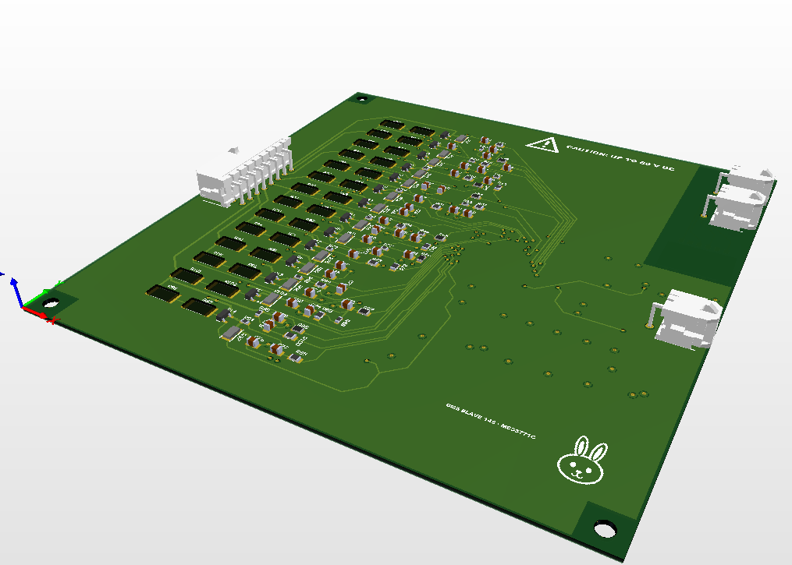
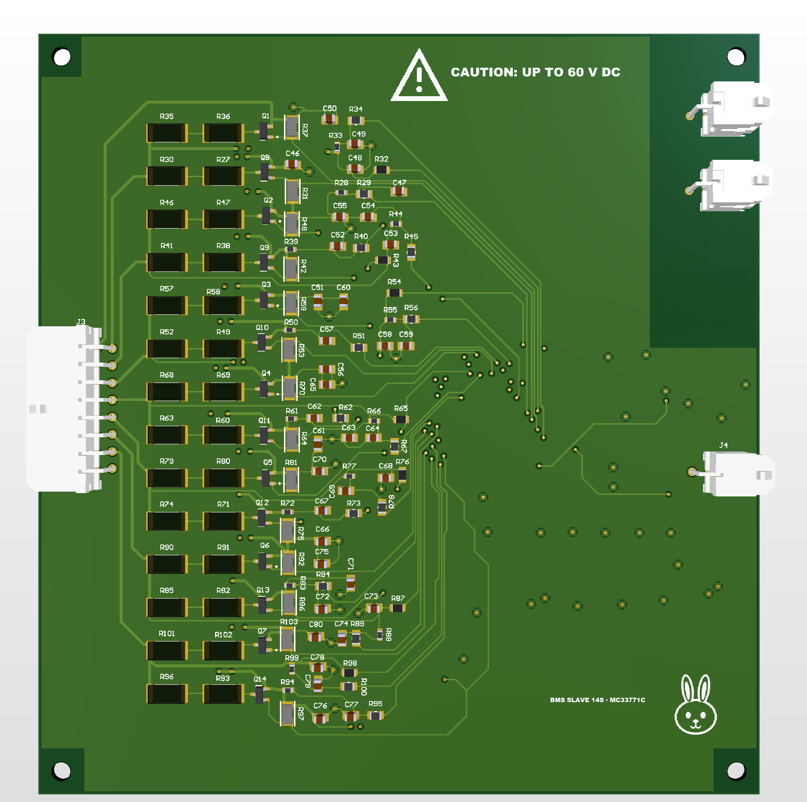

# BMS Slave Board: 14S, NXP MC33771C

A 6-layer battery management slave board for a 14-cell (14S) Li-ion stack, built around the NXP MC33771C analog front end. It measures every cell voltage, adds an external passive balancing stage of about 0.4 A per cell, reads 7 NTC temperature channels and talks to the master over an isolated, transformer-coupled daisy chain.

Designed in Altium Designer: schematic, custom footprints, placement, routing and design checks.

📄 **[Schematic (PDF)](schematic.pdf)**: no Altium needed. Two sheets: the AFE and communication sheet, and the 7 cell filter and balancing blocks. Text is searchable and nets are bookmarked.



| Top side | Bottom side |
|---|---|
|  |  |

> **Why does the top look empty on the right?** The board is populated on both sides. The AFE, its input capacitor ladder, the isolated communication section and the NTC filters all sit on the **bottom**, right under that area. The reason is explained under *Design decisions*.

### 2D layout, all layers


Red is top copper, blue is bottom copper, and the other colours are the inner signal layers. The balancing power rows run from the cell connector J3 on the left, the filter chains fan into the AFE in the middle, and the isolated daisy-chain section with transformer T1 sits on the right.

## Key specs

| | |
|---|---|
| Cells | 14S (up to 58.8 V at 4.2 V/cell, marked "UP TO 60 V DC") |
| AFE | NXP MC33771C (LQFP-64) |
| Balancing | External passive, ~0.41 A per cell (2 × 5.1 Ω 2512 in series, P/N-MOSFET per cell) |
| Temperature | 7 NTC channels |
| Communication | Isolated daisy chain (TPL) through an HM2102NL transformer |
| Battery connector | 2 × 8 Micro-Fit |
| PCB | 6 layers, 126 × 133 mm, 4 × M3 mounting holes |

## Layer stack

| Layer | Use |
|---|---|
| L1 Top | Balancing power stage, gate parts, RC filter chains |
| L2 | Plane, BAT_NEG (AFE ground reference) |
| L3 | Signal (power fan-out from the cell connector) |
| L4 | Signal |
| L5 | Plane, BAT_NEG |
| L6 Bottom | AFE, input capacitors, communication, NTC filters |

## Design decisions

**1. Balancing current and resistor choice**
The target was 0.4 A per cell. Two 5.1 Ω, 2 W 2512 resistors in series give about 0.41 A and about 0.86 W per resistor, so each part runs at roughly 43 % of its rating. An earlier version used two 10 Ω parts in parallel; that gave 0.84 A and 3.5 W per cell, and removing one of the pair would have run the other at 88 % of its rating. The internal MC33771C balancing current drives the gate of an external MOSFET through a 68 Ω / 10 Ω divider, following the datasheet's external balancing topology.

**2. Datasheet-based input filters, with higher-voltage capacitors**
Each cell input uses the RC values recommended in the MC33771C datasheet (3 kΩ, 47 nF, 2 kΩ, 100 nF, plus a 10 nF differential capacitor at the pin). The filter capacitors are referenced to the stack negative, so on the upper cells they see almost the full stack voltage (~59 V). They were changed from 50 V to **100 V** parts. The differential 10 nF capacitors only see one cell, so they stay at 50 V.

**3. Cell connector pinout follows the stack order**
The connector pinout was rearranged so that pin order follows the cell order. Adjacent pins differ by at most about 8.4 V, instead of 0 V sitting next to 58.8 V. The power rows on the board are sorted the same way, so every connector pin fans out to neighbouring rows without crossings.

**4. AFE on the bottom side, which fixes the cell order**
With the power stage sorted top to bottom, the AFE pins on the top side would have met the cell lines in reverse order, and every sense and balancing line would have crossed. Placing the AFE on the bottom mirrors its pinout, so the filter bundles reach the IC in order with no crossings.

**5. A schematic bug caught during layout**
While mapping AFE pins to filter blocks, I noticed that the block numbering on the AFE side was reversed relative to the power side. As drawn, the highest cell-sense pin would have been tied to the lowest cell, putting the supply-to-sense voltage far beyond the IC's limit and destroying it. The fix was to swap the port names between mirrored blocks in the filter sheet (1↔7, 2↔6, 3↔5). The copper on the power side did not change.

**6. Thermal and functional zoning**
The 28 balancing resistors (up to ~24 W in total if every cell balances at once) sit on the left, away from the AFE. The board is split into three zones: high-voltage power stage, filter chains, and the low-voltage AFE / communication area.

**7. Isolation and high-voltage clearance**
- Copper is removed under the communication transformer and its connectors on both internal planes, so the isolation barrier is not bridged.
- Each mounting hole has an 8 × 8 mm copper-free area on the planes. In a series pack, the board's ground can sit hundreds of volts away from chassis.
- A temporary design rule checked 0.6 mm clearance (IPC-2221, B2, external uncoated conductors, 31–100 V) between the stack negative and the rest of the high-voltage area. No violations.

## Reference

The [foxBMS](https://foxbms.org) 14S slave design (MC33775A) was used as a layout reference for filter grouping and connector-to-AFE flow.

## Status

- Schematic and layout complete. Electrical DRC is clean (clearance, short circuit, unrouted nets, width).
- **Not fabricated.** This is a portfolio design.
- Before fabrication, these would still be needed: silkscreen-to-mask and solder mask sliver rules tuned to a specific manufacturer, cell numbers on the connector silkscreen, and thermal copper under the balancing resistors.

## Ideas for Rev B

- Kelvin sense routing: split the sense trace from the balancing trace directly at the connector pad. In this revision the sense line branches off the balancing path further along, so balancing current adds a small voltage drop (on the order of 10 mV) to the measurement. The usual firmware workaround is to pause balancing during cell measurements.
- Make the board smaller. The two-sided layout leaves room to compact it.
- Add same-net copper islands and thermal vias under each balancing resistor.
- Convert the 7 identical cell blocks to an Altium multi-channel design so placement can be copied between channels.

## Repository

```
hardware/   Altium project (.PrjPcb), schematics, PCB, schematic and footprint libraries
images/     3D renders and 2D layout
schematic.pdf   Schematic export (both sheets)
fabrication/    Gerber (RS-274X) and NC drill files
```

### Fabrication files

Gerber RS-274X, metric, 4:4 format, relative origin. NC drill (Excellon) uses the same format, with plated and non-plated holes in separate files.

| File | Layer |
|---|---|
| `PCB1.GTO` / `PCB1.GTP` / `PCB1.GTS` | Top silkscreen / paste / solder mask |
| `PCB1.GTL` | L1 Top copper |
| `PCB1.GP1` | L2 BAT_NEG plane (negative) |
| `PCB1.G1` | L3 Signal |
| `PCB1.G2` | L4 Signal |
| `PCB1.GP2` | L5 BAT_NEG plane (negative) |
| `PCB1.GBL` | L6 Bottom copper |
| `PCB1.GBS` / `PCB1.GBP` / `PCB1.GBO` | Bottom solder mask / paste / silkscreen |
| `PCB1.GM1` | Board outline |
| `PCB1-Plated.TXT` | Plated holes: 130 × 0.3 mm vias, 22 × 1.016 mm connector pins |
| `PCB1-NonPlated.TXT` | Non-plated holes: 5 × 3.0 mm connector pegs, 4 × 3.2 mm M3 mounting holes |
| `PCB1.DRR` | Drill report |

Open `hardware/bms-slave-mc33771c-design.PrjPcb` in Altium Designer.

## License

Copyright 2026 Kübranur Cici.

This hardware design (schematics, PCB layout, libraries and fabrication files) is licensed under the [CERN Open Hardware Licence Version 2 - Permissive](LICENSE) (CERN-OHL-P-2.0).

Third-party component symbols, footprints, 3D models and datasheets remain subject to their original licenses.
