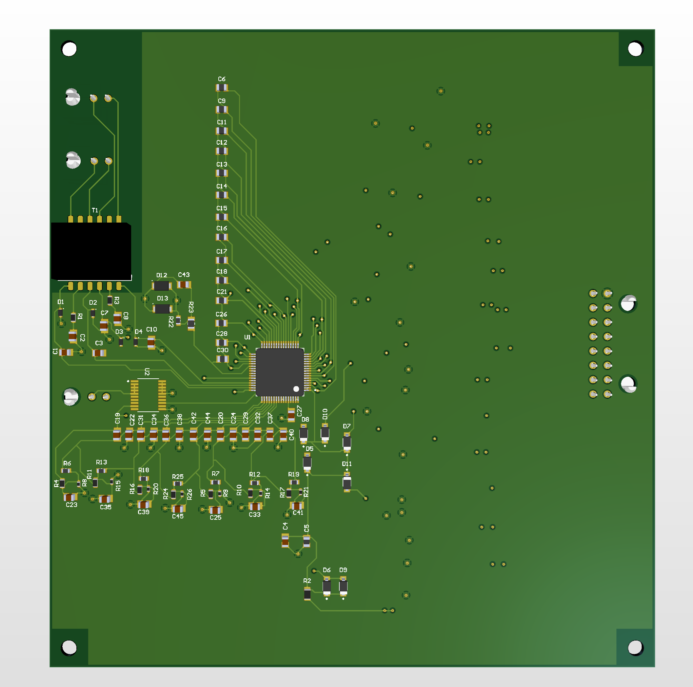
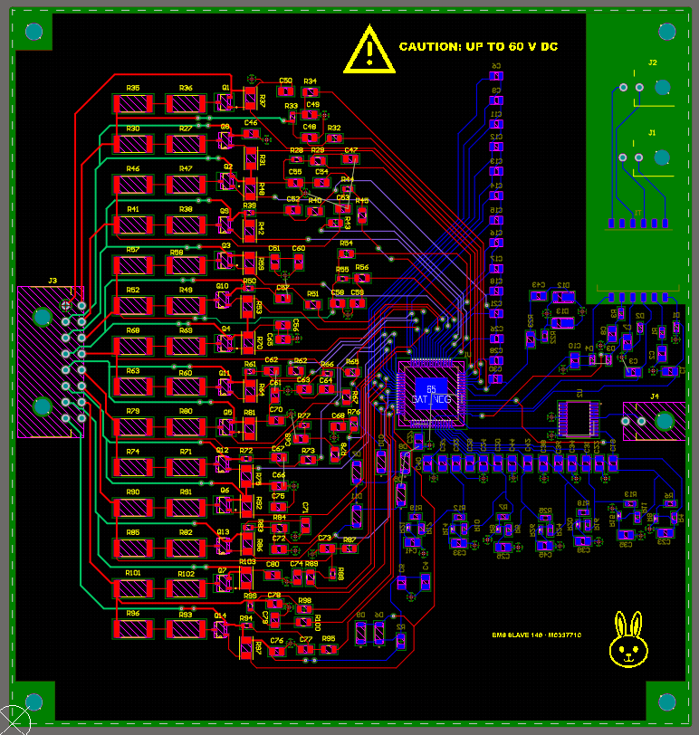

# BMS Slave Board: 14S, NXP MC33771C

A battery management slave board for a 14-cell (14S) Li-ion stack, designed around the NXP MC33771C analog front end. It measures every cell voltage, balances the cells with an external passive stage of about 0.4 A per cell, reads seven NTC temperature sensors and talks to the master over an isolated, transformer-coupled daisy chain. It is a 6-layer, 126 × 133 mm board, and I designed it in Altium Designer from the schematic and custom footprints to placement, routing and design checks.

The full schematic is available as a [PDF](schematic.pdf), so you do not need Altium to read it. It has two sheets: one for the AFE and communication, and one for the seven cell filter and balancing blocks. The text is searchable and the nets are bookmarked.


*The balancing power stage takes up the left side of the top layer. The AFE and the isolated communication section are on the bottom.*

| Top side | Bottom side |
|---|---|
|  |  |

At first glance the right half of the top side looks empty, but the board is populated on both sides. Under that area, on the bottom, are the AFE with its input capacitor ladder, the isolated communication section and the NTC filters. The reason for this split is explained below.

## Overview

| | |
|---|---|
| Cells | 14S, up to 58.8 V at 4.2 V/cell (marked "UP TO 60 V DC" on the board) |
| AFE | NXP MC33771C (LQFP-64) |
| Balancing | External passive, about 0.41 A per cell (2 × 5.1 Ω 2512 in series, one P- or N-MOSFET per cell) |
| Temperature | 7 NTC channels |
| Communication | Isolated daisy chain (TPL) through an HM2102NL transformer |
| Battery connector | 2 × 8 Micro-Fit |
| PCB | 6 layers, 126 × 133 mm, 4 × M3 mounting holes |

## Design notes

### Balancing current

My target was about 0.4 A of balancing current per cell, with the power handled outside the AFE. Following the external balancing topology in the datasheet, the MC33771C's internal balancing output drives the gate of an external MOSFET through a 68 Ω / 10 Ω divider.

Two 5.1 Ω, 2 W 2512 resistors in series give about 0.41 A and dissipate about 0.86 W each, so every resistor runs at roughly 43 % of its rating. My first version used two 10 Ω resistors in parallel. That would have meant 0.84 A and 3.5 W per cell, and with one of the pair left out, the other would have run at 88 % of its rating. The series pair is the safer choice.

### Input filters and capacitor voltage

Each cell input uses the RC values recommended in the MC33771C datasheet: 3 kΩ, 47 nF, 2 kΩ and 100 nF, plus a 10 nF differential capacitor at the pin. The filter capacitors are referenced to the stack negative, so on the upper cells they see almost the full stack voltage, about 59 V. A design review showed that this was above the rating of the 50 V parts I had first chosen. I changed them to 100 V parts. The 10 nF differential capacitors only see the voltage of one cell, so they stayed at 50 V.

### Connector pinout in stack order

I rearranged the cell connector so that its pin order follows the order of the cells. Neighbouring pins now differ by at most about 8.4 V, instead of 0 V sitting next to 58.8 V. The balancing power rows on the board are sorted the same way, so every connector pin fans out to the row next to it without crossings.

### Why the AFE is on the bottom

Once the power stage was sorted from top to bottom, placing the AFE on the top side would have brought its pins to the cell lines in reverse order, and every sense and balancing line would have had to cross. Moving the AFE to the bottom mirrors its pinout, so the filter bundles reach the IC in order and nothing crosses.

### Zoning

The 28 balancing resistors can dissipate up to about 24 W together if every cell balances at once, so they sit on the left, away from the AFE. The board is divided into three zones: the high-voltage balancing stage, the filter chains, and the low-voltage AFE and communication area.

### Isolation and high-voltage clearance

The copper on both internal planes is removed under the communication transformer and its connectors, so the isolation barrier is not bridged. Each mounting hole also has an 8 × 8 mm copper-free area on the planes, because in a series pack the board's ground can sit hundreds of volts away from the chassis.

To check the high-voltage spacing, I added a temporary design rule for 0.6 mm clearance between the stack negative and the rest of the high-voltage area (IPC-2221, B2, external uncoated conductors, 31–100 V). It reported no violations.

## Layout



*All copper layers. Red is top copper, blue is bottom copper and the other colours are the inner signal layers. The balancing power rows run from the cell connector J3 on the left, the filter chains fan into the AFE in the middle, and the isolated daisy-chain section with transformer T1 is on the right.*

| Layer | Use |
|---|---|
| L1 Top | Balancing power stage, gate parts, RC filter chains |
| L2 | BAT_NEG plane (AFE ground reference) |
| L3 | Signals (power fan-out from the cell connector) |
| L4 | Signals |
| L5 | BAT_NEG plane |
| L6 Bottom | AFE, input capacitors, communication, NTC filters |

For the filter grouping and the flow from the connector to the AFE, I used the [foxBMS](https://foxbms.org) 14S slave design (MC33775A) as a layout reference.

## Status

The schematic and layout are complete, and the electrical DRC (clearance, short circuit, unrouted nets, width) is clean. The board has **not been fabricated**; this is a portfolio design. Before ordering it, I would still tune the silkscreen-to-mask and solder mask sliver rules to a specific manufacturer, add cell numbers to the connector silkscreen, and add thermal copper under the balancing resistors.

### Ideas for a second revision

In this revision the sense line branches off the balancing path some distance after the connector, so the balancing current adds a small voltage drop, on the order of 10 mV, to the measurement. The usual firmware workaround is to pause balancing during cell measurements. A second revision should use Kelvin routing instead, splitting the sense and balancing traces directly at the connector pad.

The two-sided layout also leaves room to make the board smaller. Same-net copper islands with thermal vias under each balancing resistor would spread their heat better. Finally, the seven identical cell blocks could become an Altium multi-channel design, so that placement and routing can be copied from one channel to the others.

## Repository

```
hardware/       Altium project (.PrjPcb), schematics, PCB, schematic and footprint libraries
images/         3D renders and 2D layout
schematic.pdf   schematic export (both sheets)
fabrication/    Gerber (RS-274X) and NC drill files
```

To open the design, load `hardware/bms-slave-mc33771c-design.PrjPcb` in Altium Designer.

### Fabrication files

The Gerbers are RS-274X, metric, 4:4 format, with a relative origin. The NC drill files (Excellon) use the same format, with plated and non-plated holes in separate files.

| File | Layer |
|---|---|
| `PCB1.GTO` / `PCB1.GTP` / `PCB1.GTS` | Top silkscreen / paste / solder mask |
| `PCB1.GTL` | L1 Top copper |
| `PCB1.GP1` | L2 BAT_NEG plane (negative) |
| `PCB1.G1` | L3 Signal |
| `PCB1.G2` | L4 Signal |
| `PCB1.GP2` | L5 BAT_NEG plane (negative) |
| `PCB1.GBL` | L6 Bottom copper |
| `PCB1.GBS` / `PCB1.GBP` / `PCB1.GBO` | Bottom solder mask / paste / silkscreen |
| `PCB1.GM1` | Board outline |
| `PCB1-Plated.TXT` | Plated holes: 130 × 0.3 mm vias, 22 × 1.016 mm connector pins |
| `PCB1-NonPlated.TXT` | Non-plated holes: 5 × 3.0 mm connector pegs, 4 × 3.2 mm M3 mounting holes |
| `PCB1.DRR` | Drill report |

## License

Copyright 2026 Kübranur Cici.

This hardware design (schematics, PCB layout, libraries and fabrication files) is licensed under the [CERN Open Hardware Licence Version 2 – Permissive](LICENSE) (CERN-OHL-P-2.0). Third-party component symbols, footprints, 3D models and datasheets remain subject to their original licenses.
